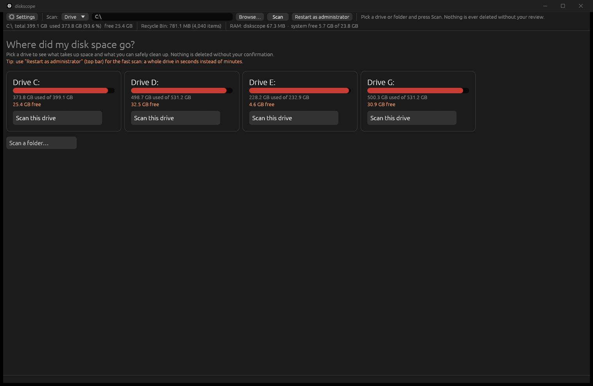
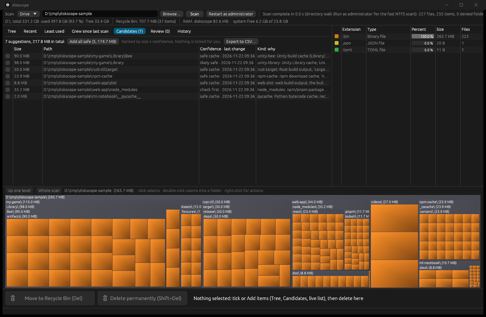
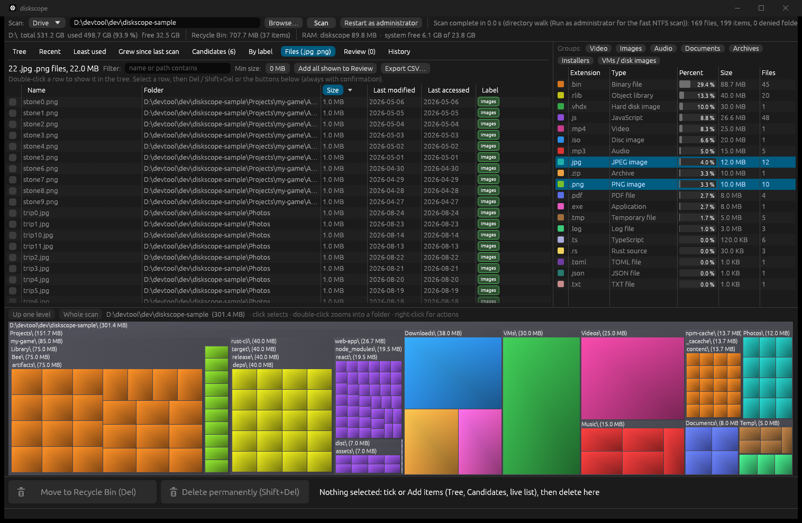
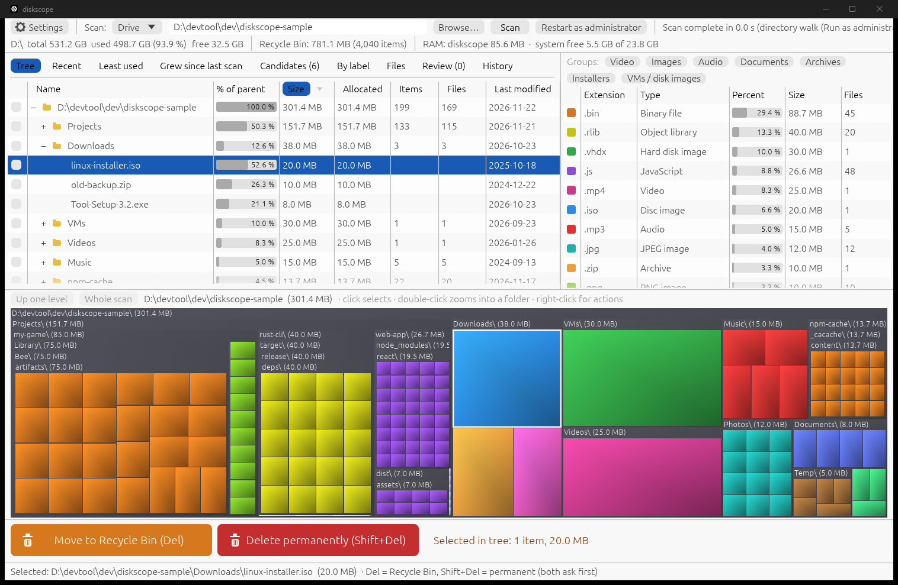
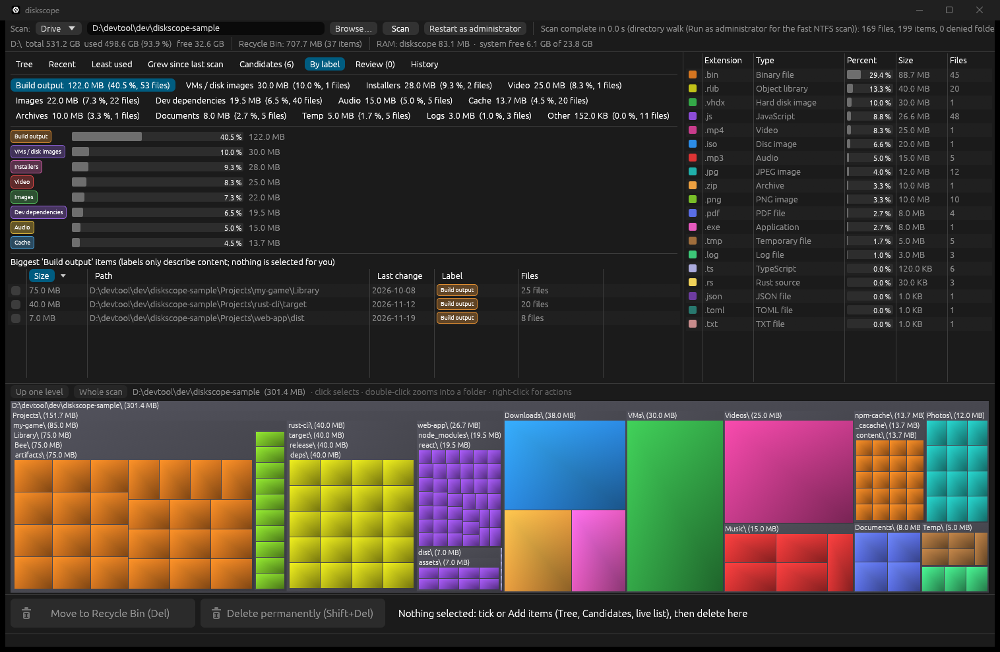

# diskscope

**A fast, safety-first disk space analyzer and cleanup tool for Windows, written in Rust.**

diskscope shows where your disk space went: a folder tree, an extension table and a treemap. It also suggests what you can safely clean up, and lets you delete only after you review and confirm.

*Inspired by WizTree. diskscope is an independent open-source project and is not affiliated with or endorsed by WizTree or its authors.*


## The problem

- **Dev machines fill up.** `node_modules`, the pnpm / npm / Yarn caches, Unity `Library` folders, Rust `target` folders, Gradle caches and old git worktrees quietly eat tens to hundreds of GB.
- **Finding the culprits is slow.** Explorer's *Properties* crawls, and classic folder walkers take minutes: diskscope's own walker needed **13.6 minutes** for a cold scan of a 3-million-item C: drive.
- **It is hard to know what is safe to delete.** Is this folder a cache that rebuilds itself, or work you still need?
- **One wrong Shift+Del is gone forever.** Most tools delete immediately.
- **There is no record of what you deleted** last week, or why the disk is suddenly full again.

## What diskscope does about it

- **Native Rust app: a single 8 MB exe.** No runtime, no installer, memory-safe code.
- **Fast NTFS scan (run as administrator).**
  - It reads the Master File Table directly, like WizTree: a 3.0M-item C: in **10.7 s** and a 6.7M-item D: in **9.5 s** on the test PC.
  - Results are within **0.4-0.6 %** of the volume's used space.
- **True space used.** Hard links (pnpm, conda) are counted once, so the numbers add up to what the disk really holds.
- **Lower memory** than the tool it was compared with (see the table below; measured numbers only).
- **Live cleanup suggestions while scanning.**
  - Results are ranked by reclaimable size × confidence: *safe cache*, *likely safe* or *check first*.
  - Each suggestion has a one-line reason and its last-change date.
  - Rules cover npm/pnpm/Yarn caches, `node_modules` of stale projects, Rust `target`, Unity `Library`/`Bee`/`Temp`, Gradle, `dist`, `__pycache__`, `.venv`, the user temp folder, older app versions in AppData, and git worktrees of finished AI-agent sessions (via the `ao` CLI, if installed).
- **Automatic labels for every item, assigned while scanning:** Cache, Dev dependencies, Build output, Temp, Logs, Installers, Archives, Video, Images, Audio, Documents, Games, VMs / disk images, App data, System, Other.
  - Folder rules such as `node_modules`, Rust `target`, a Unity `Library` or `steamapps` are inherited by their contents; other files are labelled by extension.
  - A **By label** view totals the size per label; click a label to list its biggest items.
  - Labels only describe content. They never select anything, and **System** items are never suggested for deletion.
- **Friendly from the first screen.** Big drive cards show used/free space with a Scan button. Settings (gear icon) cover text size 12-24 pt (scales the whole window), System/Light/Dark theme, accent colour and compact/comfortable rows; changes apply live and are saved in `%LOCALAPPDATA%\diskscope\settings.json`.
- **Extension drill-down.** Click an extension, or a group such as Video or Images, to list every file of that kind with path, size, dates and label. Ctrl+click adds more extensions. You can filter by name or path and by minimum size, sort, export to CSV, open the folder, or send rows to Review. It stays fast on millions of files thanks to a per-extension index of node ids.
- **Sortable everywhere:** tree, suggestions, Review, History and every list. Click a header to sort, click again to flip; the default is size, largest first. The tree sorts one folder level at a time, so it stays instant on millions of items.
- **Last-touch dates:** Last modified for every file and folder (a folder shows the newest change inside it) and Last accessed (the tooltip notes that Windows may not update access times), shown as dates with "N days ago" in the tooltip.
- **Fast, safe deletes.**
  - Permanent delete runs in parallel (32 threads); read-only files, long paths and links are handled, and links are removed, never followed.
  - The Recycle Bin is a single Windows operation for the whole selection.
  - Before running, diskscope warns if an item is bigger than that drive's Recycle Bin.
  - Progress shows items, files, GB and an ETA, with Cancel; the window stays responsive.
- **Review-first deletion.**
  - Nothing is ever ticked for you.
  - **Del** moves to the Recycle Bin. **Shift+Del** deletes permanently and requires typing `DELETE`.
  - Both show every path and the total first.
- **90-day delete History.** Searchable, exportable to CSV, and it reminds you what is still restorable from the Recycle Bin.
- **Read-only scanning.** The volume is opened for reading only. Without admin rights, diskscope falls back to a parallel folder walker.

## Measured numbers

Everything below was measured on one Windows 11 PC with an NVMe SSD (C:) on 2026-11-22. No number is estimated or taken from elsewhere.

### diskscope vs WizTree 4.31: same C: drive (3.0M items), elevated, warm (2nd of 2 runs)

| | diskscope 0.1.0 (`diskscope-cli scan C:\ --mft`) | WizTree 4.31 (`WizTree64.exe C: /export=… /exportfolders=1 /exportfiles=0`) |
|---|---|---|
| Wall time | **5.5 s** (scan + report) | 15.2 s (scan + writing an 82 MB folder CSV) |
| Peak working set | **494 MB** | 1,440 MB |

Both runs were measured by the same script, which polled each process's OS-reported peak working set. WizTree's wall time includes its CSV export, so treat the time column as indicative and the memory column as the main comparison.

### Delete speed (generated junk tree, before vs after v0.3.0)

| Operation | v0.2.0 | v0.3.0 |
|---|---|---|
| Permanent delete: 200,000 small files in 10,000 folders + 3 × 200 MB | 20.2 s | 8.7 s (10.8 s through the full confirm → execute path) |
| Recycle Bin: 500 selected folders with 10,000 files | 11.4 s | 3.6 s |

Measured with `cargo test --release --test delete_bench -- --ignored --nocapture`, which only works under its own generated folder in `D:\tmp`. Run-to-run variation was about ±2 s for the permanent case.

### diskscope on its own

| Target | Fast NTFS (MFT) scan | Folder walker (no admin) | Accuracy |
|---|---|---|---|
| C:, 3.0M items | 10.7 s (first elevated run), 5.5 s warm | 13.6 min cold, ~2 min warm | 386.3 GB allocated vs 387.9 GB volume used (−0.4 %) |
| D:, 6.7M items | 9.5 s; peak 940 MB | 4.5 min cold, 2.4 min warm; window ~450 MB | 494.4 GB vs 497.4 GB used (−0.6 %) |
| A 45 GB dev-tools folder | 5.2 s | 0.7 s warm | identical: 231,791 files, 44.8 GB |

The D: peak (940 MB) is the peak private memory of the CLI process. On folders with many hard links, the MFT scan reports less than the walker (or WizTree), because each file is counted once. Folders without hard links match to the byte.

## Download

Get `diskscope.exe` from the [latest release](https://github.com/nqvinh/diskscope/releases/latest). The SHA-256 checksum is in the release notes. It runs on Windows 10/11 x64; just start the exe.

## Quick start

1. Start `diskscope.exe`, pick a drive (or type or browse to a folder) and press **Scan**.
2. Watch the **best cleanup suggestions** appear while the scan runs. Press **Add** on the rows you want, or **Add all safe**.
3. Check the **Review** tab, or select an item in the tree.
4. Use the big buttons at the bottom:
   - **Move to Recycle Bin (Del)**: confirm in the dialog and you are done.
   - **Delete permanently (Shift+Del)**: confirm, then type `DELETE`.
5. Look back any time in **History**.











Command line: `diskscope.exe <folder>` opens and scans a folder. `diskscope.exe <folder> --select <item>` also selects an item, and `--tab candidates` (or `labels`, `files`, `history`, ...) opens a tab, `--ext .mp4,.mkv` lists the files of those extensions, and `--settings <file>` uses another settings file.

## Run as administrator for the fast scan

Reading the MFT needs administrator rights. Without them, diskscope uses its parallel folder walker and shows **Restart as administrator** in the toolbar: Windows asks once and the fast scan is used from then on. The exe never demands admin rights on its own.

## Safety model

- **Suggestions only.** Nothing is pre-selected, and "Add all safe" only fills the Review list.
- **Confirmation for every delete.** The dialog lists every path and the total, and you must tick *I reviewed every path in this list*. Permanent delete adds a second dialog where you type `DELETE`. In code, the delete function only accepts a plan built by these dialogs.
- **Recycle Bin by default.** The dialog reminds you that the bin frees no space until it is emptied. Items too big for the bin are skipped, never deleted permanently.
- **Hard blocklist**, checked when you add an item and again right before deleting it:
  - drive roots
  - `Windows`, `Program Files*` and `ProgramData\Microsoft`
  - pagefile / hiberfil / swapfile and NTFS metafiles
  - `System Volume Information` and `$Recycle.Bin`
  - user profile roots and their main folders, and the AppData roots
- **Skipped and reported**: files in use, access-denied items, and items that changed since the scan.
- **Logged.** Every action goes to `%LOCALAPPDATA%\diskscope` (History plus an action log).
- **Read-only scanning.** The volume is opened with read access only. The CLI has no delete command at all.

## How it works

**Fast path (NTFS, elevated):**
1. diskscope opens `\\.\C:` for reading and asks for the volume layout (`FSCTL_GET_NTFS_VOLUME_DATA`, a read-only query).
2. It maps `$MFT`'s own data runs, including attribute-list fragments on a heavily fragmented MFT.
3. It reads `$MFT` sequentially in 8 MiB chunks while rayon parses the FILE records in parallel. For each record it applies the update-sequence fixups, merges base and extension records, and reads the `$STANDARD_INFORMATION` times, the Win32 name (skipping DOS short names) and the unnamed `$DATA` size.
4. It builds the folder tree from the parent references.

**Fallback:** a 32-thread directory walker that never follows junctions, symlinks or mount points.

**Both paths** share one tree builder. In busy folders it groups many small files into one entry per extension, with exact totals, to keep memory low.

## Build from source

```powershell
git clone https://github.com/nqvinh/diskscope
cd diskscope
cargo build --release        # Rust 1.95 is pinned in rust-toolchain.toml
# target\release\diskscope.exe (window) and target\release\diskscope-cli.exe (read-only report)
```

## Tests

```powershell
cargo test --release
```

56 tests cover:
- the MFT record parser (on synthetic FILE records) and the tree builder
- aggregation, the treemap layout and the blocklist
- suggestion rules and ranking
- the confirmation gate, Del / Shift+Del routing, and deleting only the listed items
- small-file grouping, and junctions never being followed (on a real temporary folder)
- history append and the 90-day prune
- the extension index (totals match the table, union, filter, sort), parallel delete (read-only files, long paths, a junction inside the tree never followed, cancel) and settings round-trip
- sort order (ascending/descending, ties), the folder last-modified roll-up, label rules on sample paths, and System items never being suggested

## License

MIT, see [LICENSE](LICENSE).
